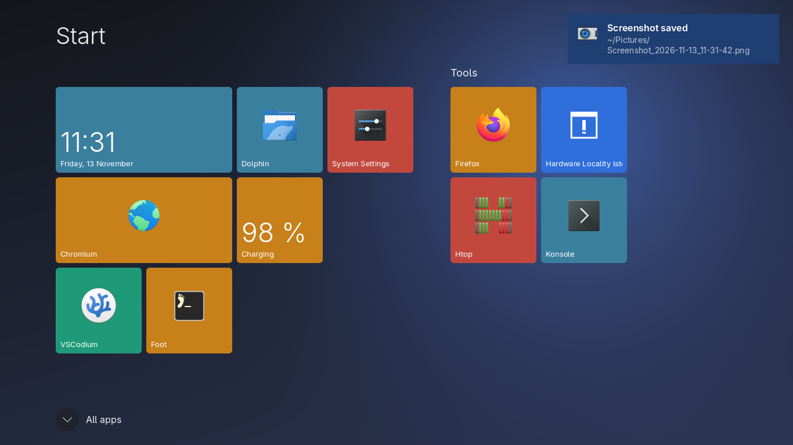
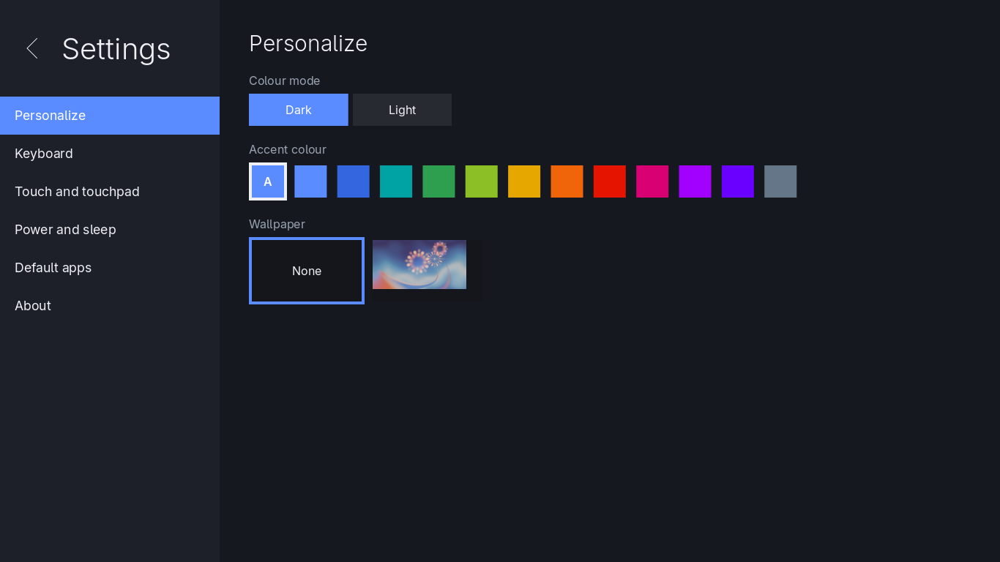
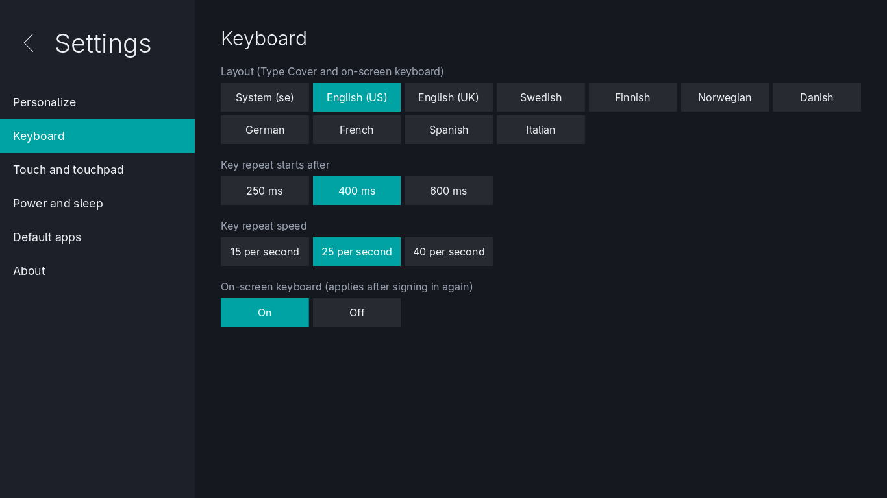
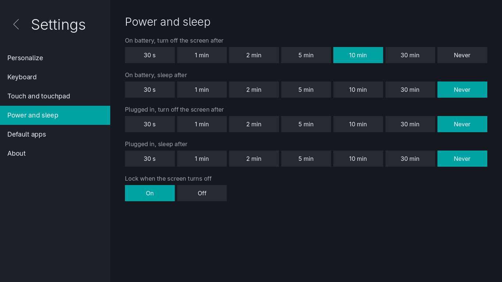
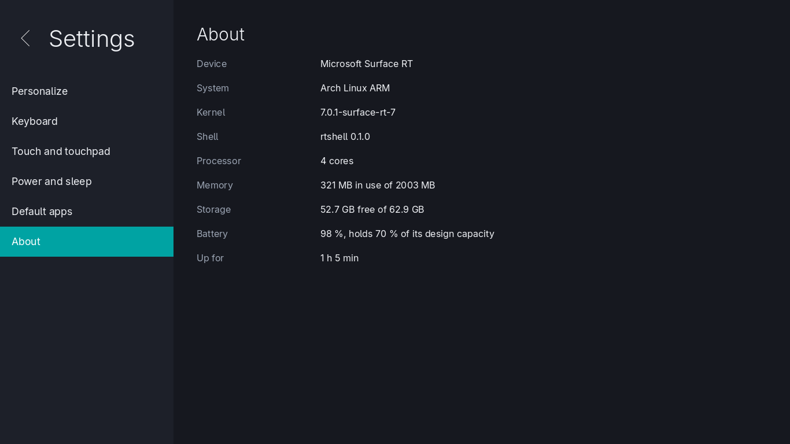

# Arch Linux ARM + KDE Plasma on the Microsoft Surface RT

Build scripts, patches and notes for running **Arch Linux ARM (armv7h)** with **KDE Plasma 6** on the
first-generation **Microsoft Surface RT** (NVIDIA Tegra 3 / T30, 2 GB RAM). The GPU is accelerated by the
open-source **grate** Mesa driver (GLES 2.0). In everyday use the desktop composites at about 60 FPS.

The system boots from a microSD card. Windows on the internal eMMC and the SPI flash are never written.

> **Status: hobby project, works on the author's device.** It is not a polished distribution. You build
> everything yourself from source (a few hours, mostly KDE under emulation). Expect rough edges and read
> [Known issues](#known-issues) first.

## What works

| Area | State |
|---|---|
| Boot | APX (tethered): each cold boot needs a Linux PC, a USB A-to-A cable and `build/fusee/boot-apx.sh` (Fusée Gelée + U-Boot in RAM). Reboots and suspend/resume don't need the PC. |
| Kernel | libre-tegra 7.0.1 + [ThatzOkay/surface-rt-patches](https://github.com/ThatzOkay/surface-rt-patches) + this project's patches 0030-0035, packaged as `linux-surface-rt` |
| GPU | mesa-grate (libre-tegra grate + surface-rt-patches + this project's grate driver patch): GLES 2.0, KWin compositing at ~60 FPS |
| Desktop | Plasma 6.8.2 on a patched KWin and Kirigami, SDDM Wayland greeter, on-screen keyboard, auto-rotation, tablet mode |
| Display, touch, Type Cover, buttons, lid | Work |
| Wi-Fi (Marvell 88W8797) | Works, **WPA2 only** (the firmware has no WPA3-SAE) |
| Bluetooth | Works with firmware you extract from your own Windows RT 8.1 driver ([docs/BLUETOOTH.md](docs/BLUETOOTH.md)) |
| Suspend/resume (LP2), DVFS 51 MHz-1.4 GHz, cpuidle, thermal, battery, sensors | Work |
| microSD | UHS-I SDR104 (~84 MB/s) from cold boot (patch 0034) |
| Audio | Devices present; listen test not done. Microphone: not working. HDMI: untested. Cameras: not enabled. |

Full component table: [docs/HARDWARE.md](docs/HARDWARE.md).

## rtshell: a lightweight touch shell

Besides Plasma, the repository contains **rtshell** (`shell/`), a touch-first Wayland compositor and shell
written in Rust on [Smithay](https://github.com/Smithay/smithay), made for this tablet. It draws everything
with GLES 2.0 on the grate driver and keeps to the Tegra 3's fill-rate limits. Its default look follows the
Windows 8/RT layout (no Microsoft artwork or fonts), and every colour, size and motion value comes from a
theme file.



| | |
|---|---|
|  |  |
|  |  |

- Start screen with live tiles, All apps and search; apps run full screen, or two side by side in split view
- Edge swipes: Home, Overview of running apps, previous app, close, Control Center (Wi-Fi, Bluetooth,
  brightness, volume, rotation, notifications)
- Built-in on-screen keyboard; Type Cover shortcuts (Super for Home, Alt+Tab, Super+A, Super+I, ...)
- Lock screen and login screen (greetd) in the same style, idle dim/blank/sleep, power button = sleep
- Settings app: light/dark, accent colour, wallpaper, keyboard layout (live), touch, power, default apps
- Screenshots (Power + Volume down, or Super+Shift+S) to `~/Pictures`
- X11 apps through Xwayland
- Light: the whole desktop uses about 210 MB of RAM (Xwayland adds ~23 MB); login to Start screen in under 2 s
- Experimental second layout, `style = "ipad"` (themes `ipad-dark` / `ipad-light`): pages of app icons, a
  floating dock with recent apps, and a pull-down search sheet

Build and install (on the PC; the sysroot is built from Arch Linux ARM packages, no emulation):

```sh
./fetch-sources.sh                    # includes Smithay + build/shell/smithay-surface-rt.patch
build/shell/mksysroot.py              # armv7h sysroot (needs mesa-grate in build/repo/surface)
build/shell/build.sh shell --release  # cross build (Rust stable, clang + lld)
build/repo/make-repo.sh               # packages rtshell 0.1.0 into the [surface] repo
```

On the Surface, install the `rtshell` package. It adds an `rtshell` session that SDDM lists next to Plasma.
`/usr/share/rtshell/greetd/` has an example greetd config for using rtshell's own login screen.
Two optional root steps on the Surface: `build/shell/surface-rt-boost.conf` in `/etc/tmpfiles.d/` lets rtshell
raise the CPU and memory clock floors while you touch the screen (faster first frame after a pause), and
`sudo sh build/shell/rtshell-login-wallpaper.sh` lets the login screen show the lock-screen wallpaper.

## Getting started

Read [docs/INSTALL.md](docs/INSTALL.md). In short:

```sh
./fetch-sources.sh                   # upstream trees at pinned commits + all patches -> sources/
docker build -t srt-cross build/docker
# kernel, U-Boot, Fusée payload, SD image, mesa-grate, KDE packages, local pacman repo:
# see docs/INSTALL.md for each command
```

You need an x86_64 Linux PC with Docker and qemu-user binfmt (for the armv7h containers). For the
pacman-repo helper scripts the PC should run Arch Linux (they use `makepkg`, `repo-add` and `vercmp`). You
also need a USB A-to-A cable and a microSD card of 16 GB or more. Disk: about 40 GB for Docker images and
build trees.

## Repository layout

```
fetch-sources.sh     clones every upstream tree at a pinned commit, applies the patches (sources/, not tracked)
build/
  docker/            srt-cross image: Debian cross toolchain (kernel, U-Boot, payloads, image assembly)
  kernel/            build.sh, config fragment, our kernel patches 0030-0035
  u-boot/            mainline U-Boot surface-rt_defconfig
  fusee/             setup.sh (payload + pyusb), boot-apx.sh (tethered APX boot), udev rule
  rootfs/            Arch Linux ARM SD image: customize.sh (in an armv7 container), overlay/, assemble.sh
  mesa/              mesa-grate PKGBUILD + our grate patch, built under qemu
  kde/               KDE package rebuilds for armv7h (fixups/ = our patches), deploy/ helpers for the tablet
  repo/              local [surface] pacman repo, kernel and rtshell packages, surface-rt-tools (hooks, Bluetooth attach),
                     safe-update tooling (REBUILD.md)
  bluetooth/         firmware install script, extractor patch (second accepted Windows driver build)
  gltest/, perf/     GPU shader tests and performance tools used during driver work
  apps/              Firefox prefs for this hardware
  shell/             rtshell cross build (sysroot, build, deploy), session script, greetd configs, Smithay patch
shell/               rtshell: the touch shell (Rust, Smithay), themes in shell/assets/themes
docs/                install guide, hardware status, GPU notes, Bluetooth, background research, roadmap
```

## Known issues

- **Tethered boot.** Cold boots need the PC (APX/RCM). Untethered EFI boot is the main open project
  ([docs/ROADMAP.md](docs/ROADMAP.md)).
- **After any normal power-off (Linux or Windows), APX mode doesn't enumerate on USB** until you hold Power for
  about 10 s. So: power off, hold Power ~10 s, then Volume Up + Power.
- Wi-Fi is WPA2 only (firmware limit).
- The GPU is GLES 2.0 class with FP20 fragment precision. Firefox and Chromium/Electron apps render in software
  (KWin still composites on the GPU). Some shaders exceed the hardware limits and fall back or are skipped.
- Microphone, HDMI, audio listen test and cameras: see [docs/HARDWARE.md](docs/HARDWARE.md).
- The text console (fbcon) shows ghosted glyphs. This is cosmetic.

## Credits

This builds directly on the work of others:

- [ThatzOkay/surface-rt-patches](https://github.com/ThatzOkay/surface-rt-patches): Surface RT kernel patches
  (audio, cover, Wi-Fi, Bluetooth, HDMI), the Mesa grate series 0001-0019 and the Bluetooth firmware extractor
- [libre-tegra](https://codeberg.org/libre-tegra) kernel and Mesa (grate driver), and the
  [grate-driver](https://github.com/grate-driver) project before it
- [Smithay](https://github.com/Smithay/smithay), the Wayland compositor library rtshell is built on
- [Open Surface RT](https://github.com/Open-Surface-RT): fusee-tools, fusee-launcher, the wiki and the
  mainline U-Boot `surface-rt_defconfig` work
- Arch Linux ARM, KDE, Mesa, U-Boot and Linux upstream

## License

See [LICENSE](LICENSE). In short, the scripts and docs in this repository are MIT-licensed. Each patch is
under the license of the project it modifies (Linux: GPL-2.0, Mesa: MIT, KDE: LGPL/GPL). No third-party
binaries or firmware are included: `fetch-sources.sh` downloads the upstream trees (including fusee-tools'
NVIDIA `nvflash` binaries) from their original locations.
